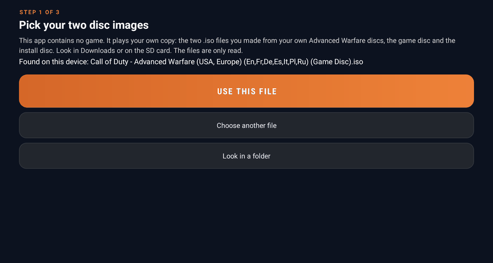
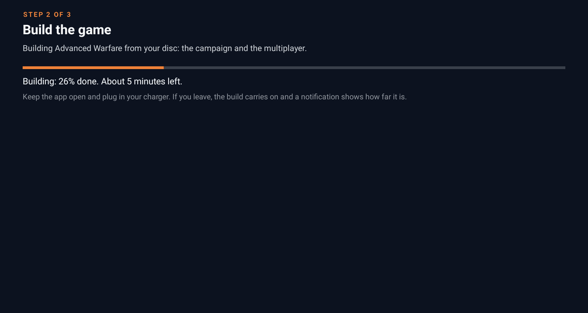
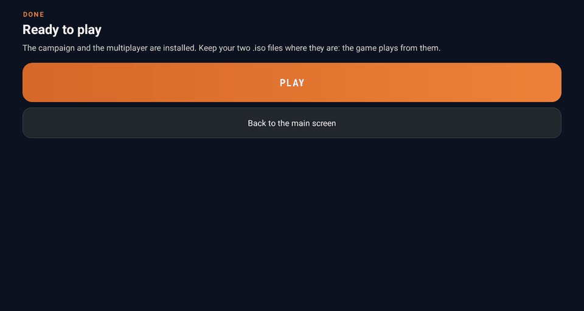

[](https://discord.gg/bTKn3Su3sp) **Help, news and requests: [join our Discord](https://discord.gg/bTKn3Su3sp).**

# AW Recompiled: Call of Duty: Advanced Warfare on Android

A native Android port of *Call of Duty: Advanced Warfare*, recompiled from
**your own Xbox 360 discs**: the campaign, multiplayer and Exo Survival in one
app. It is not an emulator and nothing is streamed: the console's code is
translated ahead of time by [XenonRecomp](https://github.com/hedge-dev/XenonRecomp)
and compiled for your device, with a small runtime standing in for the console
(Vulkan graphics, audio, controllers). It is the newest of the four ports and
the least played: **read [Known limits](#known-limits) before you start**.

> **Unofficial fan project.** Not affiliated with or endorsed by Activision or
> Microsoft. This repository contains no game data, no executables and no code
> made from them. You bring your own disc images; everything built from them
> stays on your own devices. **Never upload or share the game code package, the
> extracted files or the generated code**: they contain the game.

Other games: [Modern Warfare 3](https://github.com/yassinsolim/mw3-recomp)
(also builds for Windows) · [Modern Warfare 2](https://github.com/yassinsolim/mw2-recomp) ·
[Call of Duty 4](https://github.com/yassinsolim/cod4-recomp)

## Quick start

No PC is needed. You need both of your own *Advanced Warfare* discs as
`.iso` files, the game disc and the install disc, on the device (the
Downloads folder is fine) or on its SD card.

1. **Install the app** from [Releases](https://github.com/yassinsolim/aw-recomp/releases/latest)
   and open it. It opens on **Set up the game**.
2. **Pick your two disc images.** An `.iso` in Downloads is usually found
   by itself: tap **USE THIS FILE**. Otherwise tap **CHOOSE THE .ISO FILE**
   and tap it (you can select both at once). With both in one folder the
   second is taken along; if not, the app asks for it next. The app checks
   that they are the right game, and only reads them.
3. **Build the game.** Tap **BUILD THE GAME** and wait: about 13 minutes on
   the Retroid Pocket Flip 2 (this game is the largest of the four). The
   campaign and the multiplayer are built together. The first time, Android
   asks to allow notifications and to install the app's build tools: the
   screen says what to tap. Keep the charger in; you can leave the app, and
   a notification shows how far it is.
4. **Play.** Skip **Add your DLC** unless you have map packs, then tap
   **PLAY**. The game's first start asks you to move the brightness slider
   and then the screen margins before it takes **A**: that is the game, not
   a fault.

| 2. Pick your disc images | 3. Build the game | 4. Play |
|---|---|---|
|  |  |  |

The app updates itself. If an update needs the game built again, the app
does it by itself in the background, or the large button says **UPDATE THE
GAME**; no disc image is asked for again.

## Official downloads

- The only official APKs are on this project's [GitHub releases page](https://github.com/yassinsolim/aw-recomp/releases).
- APKs re-uploaded elsewhere (file hosts, Reddit, Discord mirrors) are not ours. They may be modified or out of date, so we can't help with problems they cause.
- The game is never provided. Build it from your own disc image, dumped from a disc you own. We don't link to download sites, and we can't help with downloaded copies.
- Reporting a problem: [open an issue](https://github.com/yassinsolim/aw-recomp/issues/new/choose) and attach the log (LOG -> SHARE in the app).
- Help, news and requests: our Discord [discord.gg/bTKn3Su3sp](https://discord.gg/bTKn3Su3sp). For bugs, attach your log (LOG -> SHARE).

## FAQ

**Build or install?** Neither is a choice any more: tap the one large button
(**SET UP THE GAME**, later **CONTINUE SETUP**). It asks for your two
`.iso` files, then builds the game. Nothing is copied: the game plays from
the `.iso` files where they are. The separate build and install screens of
older versions are under **Repair / rebuild**, and you only need them to
change something, such as copying the game into the app instead.

**Is multiplayer included?** Yes. One build makes the campaign and the
multiplayer, and the main screen then says "Ready - campaign and multiplayer
installed". **PLAY** starts the campaign; **MULTIPLAYER** is under *Play
options*, and Exo Survival is in the game's own menu.

**Where's my .iso?** The app contains no game and downloads none. The two
`.iso` files are the copies you made of your own Xbox 360 discs. Put them on
the device, in Downloads or on the SD card, and keep them there: the game
reads them every time you play. If the app does not find them by itself,
tap **CHOOSE THE .ISO FILE**, or **Look in a folder** and open the folder
they are in. If the app says a file is another game or a version it does
not support, it is not the disc this app is for (see
[What you need](#what-you-need)).

**It's slow, or the screen is black.** Open the app, tap **LOG**, then
**SHARE**, and choose **Share the log file**. Then tap **REPORT A PROBLEM**
(or [open an issue](https://github.com/yassinsolim/aw-recomp/issues/new/choose))
and attach that file. See [Known limits](#known-limits), [Tips](#tips) and
[Troubleshooting](#troubleshooting).

## What you need

- **Both of your own *Call of Duty: Advanced Warfare* Xbox 360 discs, each as
  an `.iso`** (8.7 GB each): the **game disc** (Disc 1) and the **install
  disc** (Disc 2). The game does not start without the install disc's
  content, just as the console asks you to install it first. Normal PC disc
  drives can't read Xbox 360 discs, so the dumps have to come from a drive
  that can.
- **The version:** the USA/Europe release of 2014, as it is on the discs
  (no title update). Any other game disc is refused rather than built wrong.
- **An Android 10 or newer device with a Snapdragon 865 or better**, 8 GB of
  RAM recommended. Tested: AYN Thor (Snapdragon 8 Gen 2) and Retroid Pocket
  Flip 2 (Snapdragon 865, the same chip as the Retroid Pocket 5). Mali GPUs
  are untested with this game.
- **Both `.iso` files stay on the device or its SD card** (17.5 GB): by
  default the game plays straight from them and copies nothing but its two
  executables, so the device's own storage needs only about 1 GB while the
  game is built. Or the app can copy the game out of the two images
  (7.3 GB from the game disc, 4 GB from the install disc, about 12 GB on the
  device's own storage), after which the images are no longer needed:
  **Repair / rebuild**, **Disc image and game files**.

## Supported devices and what to expect

Two devices are tested by the project, on every release. Nothing else is:
what is said of other devices below is what their players reported, and no
more.

| Device | Tested? | What to expect in Advanced Warfare |
|---|---|---|
| AYN Thor (Snapdragon 8 Gen 2, Adreno 740, 120 Hz) | **yes, every release** | 115 to 119 FPS |
| Retroid Pocket Flip 2 (Snapdragon 865, Adreno 650, 60 Hz; the Retroid Pocket 5 has the same chip) | **yes, every release** | 60 FPS |
| Snapdragon 870 (Adreno 650) | no | "runs smoothly" by one player's report |
| Snapdragon 8 Gen 1 (Adreno 730) | no | about 50 FPS by one player's report |
| POCO F6 (Snapdragon 8s Gen 3, Adreno 735) | no | 20 to 30 FPS with choppy sound by one player's report, on the version before the app measured anything |
| An unnamed device | no | "not optimised" by one player's report |
| Any other Snapdragon (Adreno 6xx, 7xx, 8xx) | no | Unknown. Expect less than a tested device of the same class, and tell us ([below](#on-a-device-we-have-not-tested)) |
| Mali, Xclipse, PowerVR | no | Unknown; see What you need above |

### On a device we have not tested

The app does not go by the chip's name. It measures the play in front of you
and gives up, in this order, what the device has no time for:

1. **Sun shadows** (Settings → Graphics → Sun shadows, *Chosen for this
   device*): on only once half a minute of play has held its frame rate
   with room to spare, off again when frames come late with them.
2. **The 3D scene's pixels**: drawn at 92% down to 58% of its size while the
   graphics chip is late with a frame, and whole again when it is not. The
   HUD and the menus keep theirs.
3. **The frame rate** (Settings → Graphics → FPS limit, *Auto*): from the
   screen's fastest rate down to an even 60 or 30 when ten seconds in a row
   did not come near it, and up again when there is room. A limit you choose
   yourself is kept whatever happens, and so are shadows you turn on or off.

The sound keeps its own time: where the processor is too busy to mix it on
time, it is buffered further ahead rather than left to crackle. An FPS limit
of 30 or 60 puts a faster screen in its 60 Hz mode, which saves power; if
the sound breaks up there (on the AYN Thor it does when other programs keep
the processor busy), the screen goes back to its fastest mode for the rest
of the run and your limit stays.

If the screen stays black, the app says so within half a minute, names the
graphics chip and the driver, and offers the other driver (the Turnip driver
the app carries, or the phone's own) and **Share log**. If it runs badly,
open the game's **Menu → Share performance report** after a minute or two of
play: it sends the frame rate, the graphics chip's time a frame, the device
and your settings as text, which is what we need to do anything about it.


## What works

Measured on 24 November 2026 on an AYN Thor (Snapdragon 8 Gen 2,
120 Hz) and a Retroid Pocket Flip 2 (Snapdragon 865, 60 Hz) with the app's
defaults. Other hardware is untested.

| | | Measured |
|---|---|---|
| Campaign: New Game, Induction (Seoul) to its rooftop | ✅ | 60 FPS on the Flip 2, 118 to 119 on the Thor |
| Campaign: a heavy level (Fusion's opening) | ✅ | 60 FPS on the Flip 2, 115 on the Thor |
| Checkpoints and Resume Game | ✅ | Flip 2: stopped the app at a checkpoint, Resume Game went on from it |
| Multiplayer: System Link with bots (up to 11) | ✅ | Team Deathmatch with 6 bots on Retreat: 60 FPS on the Flip 2, 119 on the Thor |
| Multiplayer: two devices in one match | ✅ | Thor and Flip 2 over the project's server, each hosting in turn: 119 and 60 FPS |
| Multiplayer: Find Match, through the project's server (not Xbox LIVE) | ✅ | Thor and Flip 2 met in Team Deathmatch, 119 and 60 FPS |
| Exo Survival | ⚠️ | starts from the campaign's menu and plays, alone or two together; see Known limits |
| Setting up with no PC, from a fresh install of v0.1.0 | ✅ | Flip 2: the game code built in 13 min 8 s, each disc copied in about 40 s, 18 minutes from opening the app to the game's title screen. Not run on the Thor |
| Playing from both images on an SD card, nothing copied | ✅ | Flip 2: found on the card by itself, the game is set up 2 s after the images are chosen; Seoul loads in 14 s and a match on Retreat in under 8 s, the same as from copied files |
| Your own map packs (**Add DLC**, or `setup -Dlc` / `setup.sh --dlc`) | ⚠️ | Thor: Kremlin with 6 bots and Atlas Gorge against a PC through the project's server, 119 FPS. Flip 2: Atlas Gorge against a PC, 60 FPS |
| Exo Zombies (with your map packs) | ⚠️ | Thor: Outbreak starts and plays at 119 FPS; rounds 2 to 7 only with a test build that kept the player alive. Flip 2, with the game code `setup.sh --dlc` built on Linux: its menu (version 1.20) and Outbreak load and run at 60 FPS; the match was left unattended and ended in round 1 after 30 s, nobody played it by hand |
| Split screen (Local Play) | ⚠️ | on Windows, with two controllers: a Team Deathmatch on Retreat plays. Flip 2, the second controller simulated (none was at hand): the same at 60 FPS |
| Combat Readiness Program | ✅ | a Team Deathmatch beside and against bots. Flip 2: Horizon at 60 FPS |

## Known limits

This is a first release. What has **not** been shown:

- **No level has been played from start to finish by a person.** Induction
  (Seoul) has been played through its opening to the rooftop and beyond, its
  ending was reached from a developer start point, and the next level (Atlas)
  starts from it. The other fourteen levels load from the same code; most
  were never opened. Expect a level somewhere that stops you.
- **Exo Survival's later waves have only been proven with test tools.** By
  normal play, on a device, nobody has survived round 1 yet; rounds 2 to 5
  were reached only with a test build that kept the player alive.
- **The campaign saves at every checkpoint**, where the console wrote the save
  only when you chose Save and Quit. This is on purpose (Android may close the
  app at any time), but it is not how the console behaved.
- **The frame rate is not locked.** The Flip 2 holds 60 in what was measured;
  the Thor holds 115 to 119, with Fusion at 115. The first visit to a level
  stutters while its graphics are compiled; later visits reuse what was.
- **Sun shadows are measured, not assumed**: on while the frames have room
  for them, which at 120 FPS is seldom (a setting keeps them on, at a cost).
- **Map packs and Exo Zombies need your own files** off your console: see
  [Map packs and Exo Zombies](#map-packs-and-exo-zombies). Exo Zombies was
  seen on the AYN Thor only, its later rounds only with test tools; the
  campaign stays the disc's.
- **Online play is the project's own server**, not Xbox LIVE: no ranks carry
  over, the Friends list is empty, and everyone needs the same app version.
- **Only two devices have run it.** Anything that is not a Snapdragon with an
  Adreno GPU may not start at all.

What has been checked and what is open, in detail:
[docs/AW-BRINGUP.md](docs/AW-BRINGUP.md).

## Map packs and Exo Zombies

The app plays the disc's game. The map packs and Exo Zombies are for the
updated game, and need three things of your own, copied off your console's
hard disk (`Content\0000000000000000\41560914`, the whole folder): the map
packs you bought, the free Compatibility Packs, and the game's title update.
How to copy them, and what each is for:
[docs/dlc.md](docs/dlc.md#advanced-warfare-map-packs-and-exo-zombies).

The multiplayer then has to be built a second time, as the title update
makes it. Three ways, each one step:

1. **In the app (recommended, no PC): Add DLC**, then **Choose a folder** and
   pick your `41560914` folder, wherever it is (the device's storage, an SD
   card, a USB drive). The app copies the packages and lists them. App
   versions after v0.1.1 then build the updated multiplayer on the device by
   themselves, in the background; v0.1.1 lists the packages and says that
   game code is still missing, which one of the next two builds.
2. **Windows PC**, phone connected over USB:

   ```bat
   setup\setup.cmd -Game aw -Dlc "D:\AW\41560914"
   ```
3. **Linux PC**, phone connected over USB:

   ```sh
   bash setup/setup.sh --game aw --iso ~/AW-game-disc.iso --install-iso ~/AW-install-disc.iso --dlc ~/AW/41560914
   ```

   No phone on USB (you carry files on an SD card)? Add `--no-install`: it
   builds `out/aw-game.apk` with the updated multiplayer in it and prints the
   three things to do by hand (open that APK on the phone, copy the folder,
   **Add DLC**).

Either PC command reads your folder, builds the updated multiplayer into the
game code beside the two it has, checks that it fits the published app, and
copies your packages to the phone. Run again, it skips what is built.

Afterwards **Multiplayer** starts as the updated game (its version reads
1.20 at the top right), with the packs' maps under **Bonus Maps** in a
private match or System Link, and **Exo Zombies** is an entry of its own on
the app's start screen. Everybody in a match needs the update, and for a
pack's map the pack.

**All six Compatibility Packs are needed**, whichever map packs you bought.
With one missing the updated game only shows a notice that required content
was added to your downloads, and nothing downloads here. So the app looks
for them itself: **Add DLC** names the ones still to add, its entry on the
start screen reads **ADD DLC · 2 MISSING**, and until they are all there
**Multiplayer** stays the disc's version.

## Tips

- **Bots.** Tap **Bots** under Multiplayer on the app's start screen, then
  host a **System Link** game; bots only join matches your device hosts.
- **Exo Survival** is on the game's own main menu (Campaign, Multiplayer, Exo
  Survival): the app switches over by itself.
- **Everything is unlocked** in Create a Class (Settings → Multiplayer →
  "Unlock all items", on by default).
- **Settings** are on the app's start screen: network, multiplayer, files,
  graphics. In a game, the pause menu has **Edit controls**.
- **Online** play goes through the project's relay at `mw3.yassin.app:3074`,
  which sees your IP address like any game server
  ([docs/relay.md](docs/relay.md)). **LAN** plays on your own WiFi only.
- **AYN Thor stuck at 60 Hz?** Turn on **Settings → Display → Smooth Display**
  in Android, or the refresh-rate tile in the quick settings.
- **Sharper picture.** **Settings → Internal render multiplier** draws the
  game at two or three times the console's 1280x720, from the next start of
  the game. It costs the graphics chip in proportion: on an AYN Thor in a
  match with six bots, 1x ran at 120 FPS (3.6 ms of the chip a frame), 2x at
  114 FPS with seconds down to 78 (7.6 ms), 3x at 66 FPS (14.8 ms). 2x is
  the most a Thor holds near its 120; weaker devices are best left at 1x.
- **Free the space, or keep it.** Played from the images, the game needs
  both `.iso` files where they are (an SD card is fine) and almost nothing
  on the device's own storage. Copied into the app, it needs about 12 GB
  there and the `.iso` files can go. **Settings → Change where the game is
  read from** switches between the two and offers to remove the copies.

## Troubleshooting

| Problem | What to do |
|---|---|
| "The game is not built yet" or "The game has to be built first" | Tap the large button on the main screen: it builds the game |
| "There is no .iso file of Advanced Warfare in that folder" | Open the folder the `.iso` is in and tap the `.iso` itself, or use **CHOOSE THE .ISO FILE** |
| "Play from the disc image" is greyed out (**Repair / rebuild**) | What is chosen is a folder of extracted game files, which can only be copied; the screen says so. Choose the `.iso` itself to play without copying |
| "Your .iso file is not where it was" | The SD card is out, or an `.iso` was moved or deleted: put it back, or tap the large button and pick it again |
| "This is Advanced Warfare, but not a version of the disc this app supports" | The `.iso` is not the USA/Europe disc this port was made for |
| The app asks for a second disc | The game needs both: pick the other disc's `.iso` (the install disc after the game disc) |
| Nothing happens on the Brightness screen | Move the slider left or right first, then press **A**; the same on the next screen |
| Android did not ask to install the build tools, or you tapped Cancel | Tap **Retry**. If Android says the app isn't allowed to install unknown apps: **Settings**, turn on **Allow from this source**, go back once, then **Install** |
| Not enough space | Play from the images (the default), which copies nothing; copying needs about 12 GB on the device's own storage |
| The build stopped or failed | What was done is kept: tap **Retry**. If it fails again, tap **Share log** under it and attach the file to an issue |
| Can't connect online, or friends don't see your game | **Settings → Network** on **Online** (restart the game after changing it); everyone on the same app version; the host must have *started* the match |
| System Link: the other device's game is not listed, or the overlay says `LAN: 0` | Both devices must be on the same Wi-Fi network, behind the same router. With two routers, a mesh's second network or a guest network they cannot hear each other: set **Settings → Network** to **Online** on both (restart the game) |
| Black screen | Within half a minute the app says why, or that no picture has come, with the graphics chip and driver: try the other driver it offers (or **Settings → Graphics driver**) and send **Share log** |
| Low frame rate or choppy sound | **Menu → Share performance report** in the game after a minute of play, and send it; see [Supported devices](#supported-devices-and-what-to-expect) |
| Crash on a non-Qualcomm phone | Untested hardware; the app's **Log** screen says what happened |
| `setup.cmd` problems | Logs are in `out\logs\`; use a short path such as `C:\aw`; accept the USB debugging prompt on the phone |
| `setup.sh` says `unknown option: --dlc` | The folder is older than the option: `git pull` (or download the repository again), then run the same command |
| `setup.sh` says programs are needed | Run the one `sudo apt install …` line it prints, then the same command again; it carries on where it stopped. Its logs are in `out/logs/` |
| "Unsupported Advanced Warfare executable" from setup | The image given as the game disc is the install disc, or another pressing. Update the folder (`git pull`): setup now sorts the two images out by itself and deletes an executable it refused. On an older folder, delete `aw/tu0/` and give the game disc's image as `--iso` |
| **Add DLC** lists your packs but says the game code of the updated multiplayer is missing | The packs are in place; the updated multiplayer has not been built. A newer app builds it on the device by itself; otherwise run one of the two PC commands under [Map packs and Exo Zombies](#map-packs-and-exo-zombies) |
| The start screen reads **ADD DLC · 2 MISSING**, or (app v0.1.7 and older) Multiplayer only shows a notice that required content was added to your downloads | The updated game needs all six free Compatibility Packs and you added fewer. **Add DLC** names the missing ones: they are in `Content\0000000000000000\41560914\00000002` on the console's hard disk beside the map packs. Copy them and add them the same way; until then Multiplayer is the disc's version |
| The app refuses the game code after you built the updated multiplayer by hand | A game library built outside setup does not carry the statement the app checks. Run `setup.sh --dlc` (or `setup.cmd -Dlc`): it builds all three libraries the way the app expects and says whether they fit the published app |
| Choosing Campaign shows "An installed Content Pack is corrupt. It must be deleted to continue." (app v0.1.2) | Nothing of yours is corrupt and nothing needs deleting: with eleven or more packs added, the campaign was shown your packs ahead of its own install files. Update the app; your packs, saves and game code stay as they are |
| **Add DLC** says a pack "is damaged" or "is incomplete: copy it again from your console" | The copy of that one file went wrong (a cable pulled, a full card). Copy the named file again from the console's hard disk and add it again; the other packs are not affected |

Bug reports are welcome with the log (the app's **Log** screen), the device
and the level.

<details>
<summary><b>For developers</b></summary>

This is the same code as [mw3-recomp](https://github.com/yassinsolim/mw3-recomp);
the repositories differ only in which app their releases carry.

- How it works: [docs/AW-BRINGUP.md](docs/AW-BRINGUP.md),
  [docs/ANDROID-ARCHITECTURE.md](docs/ANDROID-ARCHITECTURE.md),
  [docs/runtime.md](docs/runtime.md), [docs/rendering.md](docs/rendering.md),
  [docs/multiplayer.md](docs/multiplayer.md),
  [docs/building.md](docs/building.md).
- The app and the game code are two packages, checked against each other when
  the game starts: [docs/game-library.md](docs/game-library.md). The app
  carries no game code; `tools/check_runtime_apk.py` refuses one that does.
- Asset-free tests: `cmake -S . -B build-tests -G Ninja -DMW2_TESTS_ONLY=ON && cmake --build build-tests && ctest --test-dir build-tests`
- Releasing: [docs/android-releases.md](docs/android-releases.md). Changes:
  [CHANGELOG.md](CHANGELOG.md).
- `tools/check_no_game_files.py` (also `--staged`, as a pre-commit check)
  refuses commits that carry game data. Never commit or publish anything from
  `aw/`, `ppc_*/`, `out/` or a build folder.

</details>

## PC setup and other ways (advanced)

The app builds the game by itself; you need none of this to play. It is for
building on a PC instead, and for the Windows game.

<details>
<summary><b>Other ways to install</b></summary>

- **Windows PC**: get the code (`git clone https://github.com/yassinsolim/aw-recomp.git C:\aw`,
  a short path without spaces), connect the phone over USB with USB debugging
  on, and run

  ```
  setup\setup.cmd -Game aw -Iso "D:\Games\AW-game-disc.iso" -InstallIso "D:\Games\AW-install-disc.iso" -Install -PushIso
  ```

  It downloads what it needs into `.toolchain\` (only Microsoft's C++ Build
  Tools are installed system-wide, with your leave), builds `out\aw-game.apk`,
  installs it with the published app, copies the install disc's content to
  the phone and the game disc's image to its Download folder. `-Build pc` or
  `-Build both` makes the Windows game as well, in `out\pc-aw`. After an app
  update that needs new game code: `git pull`, then
  `setup\setup.cmd -Game aw -GameOnly`. `-Check` lists what it would do and
  changes nothing.
- **Linux PC** (tested on Ubuntu 24.04, WSL2 included; Linux Mint 22 is the
  same underneath), with the phone connected over USB:

  ```sh
  git clone https://github.com/yassinsolim/aw-recomp.git && cd aw-recomp
  bash setup/setup.sh --game aw --iso ~/Downloads/AW-game-disc.iso --install-iso ~/Downloads/AW-install-disc.iso --install --push-iso
  ```

  It first names the system programs it lacks, with the one command that
  installs them (`sudo apt install git curl unzip python3 openssl clang`),
  and needs no `sudo` itself. The two images given the wrong way round are
  taken the right way round. `--game-only` rebuilds the game code after an
  update; `--no-install` builds without a phone and says what to copy to it.
- **GitHub builds it for you**: not available for this game.

How the on-device build works and what was measured:
[docs/ondevice-build.md](docs/ondevice-build.md). The other ways, step by
step: [docs/BUILD-WITHOUT-PC.md](docs/BUILD-WITHOUT-PC.md).

</details>

## Credits

This port stands on the work of others:

- [mw2-recompiled](https://github.com/PaulCombal/mw2-recompiled) by Paul
  Combal and contributors: the runtime, the recompilation pipeline, the relay
  and the online play all of this grew from
- mw2-android, the original Android port by Player124413 and OpenPort-Labs
  (its repository no longer answers), and its fork
  [flavinxs0/mw2-android](https://github.com/flavinxs0/mw2-android) by
  flavinxs0 and contributors: the Android layer
- [XenonRecomp](https://github.com/hedge-dev/XenonRecomp) (hedge-dev): the
  PowerPC recompiler
- [Xenia](https://github.com/xenia-project/xenia): the reference for the
  console's behaviour, and its FFmpeg branch's XMA decoder
- [LLVM](https://github.com/llvm/llvm-project) (clang and lld in the on-device
  build tools) and [AOSP bionic](https://android.googlesource.com/platform/bionic)'s headers
- [libadrenotools](https://github.com/bylaws/libadrenotools) and
  [Mesa Turnip](https://gitlab.freedesktop.org/mesa/mesa) (builds by
  [StevenMXZ](https://github.com/StevenMXZ/Adreno-Tools-Drivers)): the
  graphics driver on Adreno
- [mw3recomp](https://github.com/the-drk/mw3recomp) by DrK: the *Modern
  Warfare 3* desktop bring-up this runtime also carries
- [mw3-recomp](https://github.com/yassinsolim/mw3-recomp), this project: the
  renderer and Android work since, the app that updates itself and the game
  code as a package of its own

The full list of credits
([mw3-recomp's README](https://github.com/yassinsolim/mw3-recomp#credits))
and the licences: [THIRD_PARTY.md](THIRD_PARTY.md).

## Licence

The code in this repository is licensed under the
[GNU General Public License v3.0 only](LICENSE), as the projects it derives
from are. Third-party components keep their own licences
([THIRD_PARTY.md](THIRD_PARTY.md)).

## Disclaimer

This is an unofficial fan project. It is not affiliated with, endorsed by or
sponsored by Activision, Sledgehammer Games, High Moon Studios or Microsoft.
*Call of Duty* and *Call of Duty: Advanced Warfare* are trademarks of
Activision Publishing, Inc.; *Xbox 360* and *Xbox LIVE* are trademarks of
Microsoft. No game content is distributed here: you need your own legally
obtained copy of the game, and what you build from it is for your own use
only.
