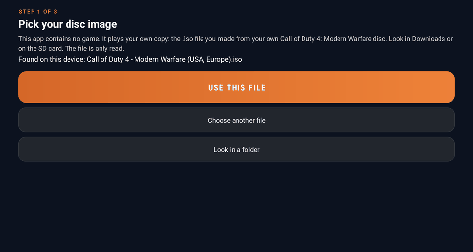
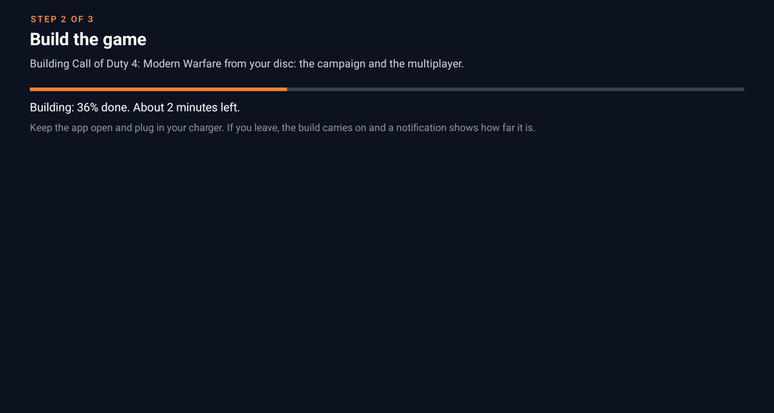
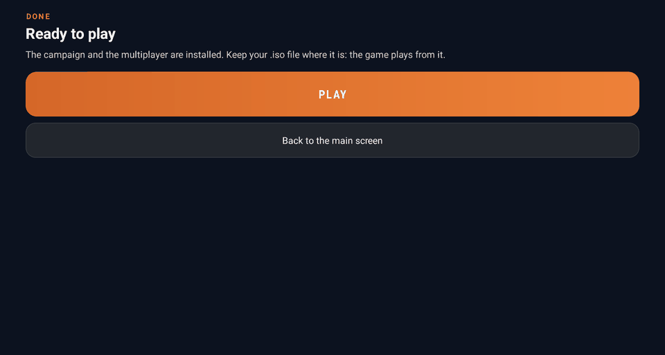

# CoD4 Recompiled: Call of Duty 4: Modern Warfare on Android

A native Android port of *Call of Duty 4: Modern Warfare*, recompiled from
**your own Xbox 360 disc**: the campaign and multiplayer in one app. It is not
an emulator and nothing is streamed: the console's code is translated ahead of
time by [XenonRecomp](https://github.com/hedge-dev/XenonRecomp) and compiled
for your device, with a small runtime standing in for the console (Vulkan
graphics, audio, controllers). It is the newest of the three ports and the
least played: expect rough edges.

> **Unofficial fan project.** Not affiliated with or endorsed by Activision or
> Microsoft. This repository contains no game data, no executables and no code
> made from them. You bring your own disc image; everything built from it stays
> on your own devices. **Never upload or share the game code package, the
> extracted files or the generated code**: they contain the game.

Other games: [Modern Warfare 3](https://github.com/yassinsolim/mw3-recomp)
(also builds for Windows) · [Modern Warfare 2](https://github.com/yassinsolim/mw2-recomp) ·
[Advanced Warfare](https://github.com/yassinsolim/aw-recomp)

## Quick start

No PC is needed. You need your own *Call of Duty 4: Modern Warfare* disc as
an `.iso` file, on the device (the Downloads folder is fine) or on its SD
card.

1. **Install the app** from [Releases](https://github.com/yassinsolim/cod4-recomp/releases/latest)
   and open it. It opens on **Set up the game**.
2. **Pick your disc image.** An `.iso` in Downloads is usually found by
   itself: tap **USE THIS FILE**. Otherwise tap **CHOOSE THE .ISO FILE** and
   tap it. The app checks that it is the right game, and only reads it.
3. **Build the game.** Tap **BUILD THE GAME** and wait: about 2 minutes on
   the AYN Thor, 4 on the Retroid Pocket Flip 2. The campaign and the
   multiplayer are built together. The first time, Android asks to allow
   notifications and to install the app's build tools: the screen says what
   to tap. Keep the charger in; you can leave the app, and a notification
   shows how far it is.
4. **Play.** Skip **Add your DLC** unless you have map packs, then tap
   **PLAY**.

| 2. Pick your disc image | 3. Build the game | 4. Play |
|---|---|---|
|  |  |  |

The app updates itself. If an update needs the game built again, the app
does it by itself in the background, or the large button says **UPDATE THE
GAME**; no disc image is asked for again.

## Official downloads

- The only official APKs are on this project's [GitHub releases page](https://github.com/yassinsolim/cod4-recomp/releases).
- APKs re-uploaded elsewhere (file hosts, Reddit, Discord mirrors) are not ours. They may be modified or out of date, so we can't help with problems they cause.
- The game is never provided. Build it from your own disc image, dumped from a disc you own. We don't link to download sites, and we can't help with downloaded copies.
- Reporting a problem: [open an issue](https://github.com/yassinsolim/cod4-recomp/issues/new/choose) and attach the log (LOG -> SHARE in the app).

## FAQ

**Build or install?** Neither is a choice any more: tap the one large button
(**SET UP THE GAME**, later **CONTINUE SETUP**). It asks for your `.iso`,
then builds the game. Nothing is copied: the game plays from the `.iso`
where it is. The separate build and install screens of older versions are
under **Repair / rebuild**, and you only need them to change something.

**Is multiplayer included?** Yes. One build makes the campaign and the
multiplayer, and the main screen then says "Ready - campaign and multiplayer
installed". **PLAY** starts the campaign; **MULTIPLAYER** is under *Play
options*.

**Where's my .iso?** The app contains no game and downloads none. The `.iso`
is the copy you made of your own Xbox 360 disc. Put it on the device, in
Downloads or on the SD card, and keep it there: the game reads it every time
you play. If the app does not find it by itself, tap **CHOOSE THE .ISO
FILE**, or **Look in a folder** and open the folder it is in. If the app
says the file is another game or a version it does not support, it is not
the disc this app is for (see [What you need](#what-you-need)).

**It's slow, or the screen is black.** Open the app, tap **LOG**, then
**SHARE**, and choose **Share the log file**. Then tap **REPORT A PROBLEM**
(or [open an issue](https://github.com/yassinsolim/cod4-recomp/issues/new/choose))
and attach that file. The first visit to a level may stutter while its
graphics are compiled; see [Tips](#tips) and [Troubleshooting](#troubleshooting).

## What you need

- **Your own *Call of Duty 4: Modern Warfare* disc as an `.iso`** (about
  7.8 GB). Normal PC disc drives can't read Xbox 360 discs, so the dump has to
  come from a drive that can. Only the USA/Europe disc (2007) is accepted; any
  other is refused rather than built wrong.
- **An Android 10 or newer device with a Snapdragon 865 or better**, 8 GB of
  RAM recommended. Tested: AYN Thor and Retroid Pocket Flip 2. Mali GPUs from
  the G57 up are untested; Mali G52 and G76 (and older) are not supported.
- **About 8 GB free** for the disc image, on the device or an SD card, plus
  about 1 GB while the game is built.

## Supported devices and what to expect

Two devices are tested by the project, on every release. Nothing else is:
what is said of other devices below is what their players reported, and no
more.

| Device | Tested? | What to expect in Call of Duty 4 |
|---|---|---|
| AYN Thor (Snapdragon 8 Gen 2, Adreno 740, 120 Hz) | **yes, every release** | 117 to 119 FPS |
| Retroid Pocket Flip 2 (Snapdragon 865, Adreno 650, 60 Hz; the Retroid Pocket 5 has the same chip) | **yes, every release** | 59.5 to 60 FPS |
| POCO F6 (Snapdragon 8s Gen 3, Adreno 735) | no | 120 FPS by one player's report |
| Any other Snapdragon (Adreno 6xx, 7xx, 8xx) | no | Unknown. Expect less than a tested device of the same class, and tell us ([below](#on-a-device-we-have-not-tested)) |
| Mali, Xclipse, PowerVR | no | Unknown; see What you need above |

### On a device we have not tested

The app does not go by the chip's name. It measures the play in front of you
and gives up, in this order, what the device has no time for:

1. **Sun shadows** (Settings → Graphics → Sun shadows, *Chosen for this
   device*): on only once half a minute of play has held its frame rate
   with room to spare, off again when frames come late with them.
2. **The 3D scene's pixels**: drawn at 92% down to 58% of its size while the
   graphics chip is late with a frame, and whole again when it is not. The
   HUD and the menus keep theirs.
3. **The frame rate** (Settings → Graphics → FPS limit, *Auto*): from the
   screen's fastest rate down to an even 60 or 30 when ten seconds in a row
   did not come near it, and up again when there is room. A limit you choose
   yourself is kept whatever happens, and so are shadows you turn on or off.

The sound keeps its own time: where the processor is too busy to mix it on
time, it is buffered further ahead rather than left to crackle. An FPS limit
of 30 or 60 puts a faster screen in its 60 Hz mode, which saves power; if
the sound breaks up there (on the AYN Thor it does when other programs keep
the processor busy), the screen goes back to its fastest mode for the rest
of the run and your limit stays.

If the screen stays black, the app says so within half a minute, names the
graphics chip and the driver, and offers the other driver (the Turnip driver
the app carries, or the phone's own) and **Share log**. If it runs badly,
open the game's **Menu → Share performance report** after a minute or two of
play: it sends the frame rate, the graphics chip's time a frame, the device
and your settings as text, which is what we need to do anything about it.


## What works

Measured on 23 November 2026 on an AYN Thor (Snapdragon 8 Gen 2, 120 Hz) and a
Retroid Pocket Flip 2 (Snapdragon 865, 60 Hz) with the app's defaults. Other
hardware is untested.

| | | Measured |
|---|---|---|
| Campaign | ✅ | F.N.G. 119 FPS on the Thor, 60 on the Flip; Crew Expendable 119 and 60; Charlie Don't Surf 117 and 59.5 |
| Multiplayer: System Link | ✅ | Thor and Flip in one match on Backlot, 119 and 60 FPS; Crash 119 and 60 |
| Multiplayer: Find Match, through the project's server (not Xbox LIVE) | ✅ | Team Deathmatch and Free-for-all, Thor and Flip, 119 and 60 FPS |
| Bots in matches your device hosts | ✅ | six on Crash on the Flip for ten minutes, 60 FPS; not run on the Thor |
| Checkpoints on Android | ❔ | work on Windows; not checked on Android |
| Split screen | ⚠️ | on Windows, with two controllers: a Team Deathmatch on Backlot plays. Flip 2, the second controller simulated (none was at hand): the same at 60 FPS |
| Xbox LIVE invitations | ❔ | not tested |

Only three campaign levels and two multiplayer maps have been played for more
than a few minutes; the rest load from the same code but were not checked one
by one. Charlie Don't Surf stutters where the helicopters land. What has been
checked and what is open: [docs/COD4-BRINGUP.md](docs/COD4-BRINGUP.md).

## Tips

- **Playing from the ISO.** The game reads its files out of the `.iso` where it
  lies, on the device or an SD card, so keep it there. **Settings → Files**
  copies the game into the app instead (about 7 GB more) and moves it back.
- **AYN Thor stuck at 60 Hz?** Turn on **Settings → Display → Smooth Display**
  in Android, or the refresh-rate tile in the quick settings. The dual-screen
  assistant can turn it off again after a restart.
- **Your own map packs (DLC), untested with a real pack.** Copy
  `Content\0000000000000000\415607E6\00000002` off your Xbox 360's hard
  disk, then **Add DLC → Choose a folder** in the app. Only a test package
  made from the disc has been tried (it played Shipment), never the Variety
  Map Pack, whose maps the disc's menus do not list. Online, every player
  needs the map's pack: [docs/dlc.md](docs/dlc.md).
- **Bots.** Tap **Bots** under Multiplayer, then host a **System Link** game;
  bots only join matches your device hosts.
- **Settings** are on the app's start screen: network, multiplayer, files,
  graphics. In a game, the pause menu has **Edit controls**.
- **Online** play goes through the project's relay at `mw3.yassin.app:3074`,
  which sees your IP address like any game server
  ([docs/relay.md](docs/relay.md)). **LAN** plays on your own WiFi only.
- **Sun shadows** are on while the frames have room for them, which at 120
  FPS is seldom: with them the Thor drops to 114 to 115 with many late
  frames. **Settings → Graphics → Sun shadows → On** keeps them.
- The first visit to a level may stutter while its graphics are compiled;
  later visits reuse what was.

## Troubleshooting

| Problem | What to do |
|---|---|
| "The game is not built yet" or "The game has to be built first" | Tap the large button on the main screen: it builds the game |
| "This is Call of Duty 4: Modern Warfare, but not a version of the disc this app supports" | The `.iso` is not the USA/Europe disc this port was made for |
| The build stopped or failed | What was done is kept: tap **Retry**. If it fails again, tap **Share log** under it and attach the file to an issue |
| Android did not ask to install the build tools, or you tapped Cancel | Tap **Retry**. If Android says the app isn't allowed to install unknown apps: **Settings**, turn on **Allow from this source**, go back once, then **Install** |
| Stuck at 60 Hz on the AYN Thor | See Tips: Smooth Display |
| Can't connect online, or friends don't see your game | **Settings → Network** on **Online** (restart the game after changing it); everyone on the same app version; the host must have *started* the match |
| System Link: the other device's game is not listed, or the overlay says `LAN: 0` | Both devices must be on the same Wi-Fi network, behind the same router. With two routers, a mesh's second network or a guest network they cannot hear each other: set **Settings → Network** to **Online** on both (restart the game) |
| "Your .iso file is not where it was" | Put the `.iso` back (SD card, moved file), or tap the large button and pick it again |
| Black screen | Within half a minute the app says why, or that no picture has come, with the graphics chip and driver: try the other driver it offers (or **Settings → Graphics driver**) and send **Share log** |
| Low frame rate or choppy sound | **Menu → Share performance report** in the game after a minute of play, and send it; see [Supported devices](#supported-devices-and-what-to-expect) |
| Crash on a non-Qualcomm phone | Untested hardware; the app's **Log** screen says what happened |
| `setup.cmd` problems | Logs are in `out\logs\`; use a short path such as `C:\cod4`; accept the USB debugging prompt on the phone |

Bug reports are welcome with the log file (**LOG**, then **SHARE**, or
**REPORT A PROBLEM** on the main screen).

<details>
<summary><b>For developers</b></summary>

This is the same code as [mw3-recomp](https://github.com/yassinsolim/mw3-recomp);
the repositories differ only in which app their releases carry.

- How it works: [docs/COD4-BRINGUP.md](docs/COD4-BRINGUP.md),
  [docs/ANDROID-ARCHITECTURE.md](docs/ANDROID-ARCHITECTURE.md),
  [docs/runtime.md](docs/runtime.md), [docs/rendering.md](docs/rendering.md),
  [docs/multiplayer.md](docs/multiplayer.md),
  [docs/building.md](docs/building.md).
- The app and the game code are two packages, checked against each other when
  the game starts: [docs/game-library.md](docs/game-library.md). The app
  carries no game code; `tools/check_runtime_apk.py` refuses one that does.
- Asset-free tests: `cmake -S . -B build-tests -G Ninja -DMW2_TESTS_ONLY=ON && cmake --build build-tests && ctest --test-dir build-tests`
- Releasing: [docs/android-releases.md](docs/android-releases.md). Changes:
  [CHANGELOG.md](CHANGELOG.md).
- `tools/check_no_game_files.py` (also `--staged`, as a pre-commit check)
  refuses commits that carry game data. Never commit or publish anything from
  `cod4/`, `ppc_*/`, `out/` or a build folder.

</details>

## PC setup and other ways (advanced)

The app builds the game by itself; you need none of this to play. It is for
building on a PC instead, and for the Windows game.

<details>
<summary><b>Other ways to install</b></summary>

- **Windows PC**: get the code (`git clone https://github.com/yassinsolim/cod4-recomp.git C:\cod4`,
  a short path without spaces), connect the phone over USB with USB debugging
  on, and run

  ```
  setup\setup.cmd -Game cod4 -Iso "D:\Games\CoD4.iso" -Install -PushIso
  ```

  It downloads what it needs into `.toolchain\` (only Microsoft's C++ Build
  Tools are installed system-wide, with your leave), builds `out\cod4-game.apk`
  and installs it with the app. `-Build pc` or `-Build both` makes the Windows
  game as well, in `out\pc-cod4`. After an app update that needs new game
  code: `git pull`, then `setup\setup.cmd -Game cod4 -GameOnly`. `-Check` lists
  what it would do and changes nothing.
- **Linux PC** (tested on Ubuntu 24.04, WSL2 included), with the phone
  connected over USB:

  ```sh
  git clone https://github.com/yassinsolim/cod4-recomp.git && cd cod4-recomp
  bash setup/setup.sh --game cod4 --iso ~/Downloads/CoD4.iso --install --push-iso
  ```

  `--game-only` rebuilds the game code after an update.
- **GitHub builds it for you** (no PC, a private repository of your own): not
  available yet.

Every way, step by step: [docs/BUILD-WITHOUT-PC.md](docs/BUILD-WITHOUT-PC.md).
How the on-device build works and what was measured:
[docs/ondevice-build.md](docs/ondevice-build.md).

</details>

## Credits

This port stands on the work of others:

- [mw2-recompiled](https://github.com/PaulCombal/mw2-recompiled) by Paul
  Combal and contributors: the runtime, the recompilation pipeline, the relay
  and the online play all of this grew from
- mw2-android, the original Android port by Player124413 and OpenPort-Labs
  (its repository no longer answers), and its fork
  [flavinxs0/mw2-android](https://github.com/flavinxs0/mw2-android) by
  flavinxs0 and contributors: the Android layer
- [XenonRecomp](https://github.com/hedge-dev/XenonRecomp) (hedge-dev): the
  PowerPC recompiler
- [Xenia](https://github.com/xenia-project/xenia): the reference for the
  console's behaviour, and its FFmpeg branch's XMA decoder
- [LLVM](https://github.com/llvm/llvm-project) (clang and lld in the on-device
  build tools) and [AOSP bionic](https://android.googlesource.com/platform/bionic)'s headers
- [libadrenotools](https://github.com/bylaws/libadrenotools) and
  [Mesa Turnip](https://gitlab.freedesktop.org/mesa/mesa) (builds by
  [StevenMXZ](https://github.com/StevenMXZ/Adreno-Tools-Drivers)): the
  graphics driver on Adreno
- [mw3recomp](https://github.com/the-drk/mw3recomp) by DrK: the *Modern
  Warfare 3* desktop bring-up this runtime also carries
- [mw3-recomp](https://github.com/yassinsolim/mw3-recomp), this project: the
  renderer and Android work since, the app that updates itself and the game
  code as a package of its own

The full list of credits
([mw3-recomp's README](https://github.com/yassinsolim/mw3-recomp#credits))
and the licences: [THIRD_PARTY.md](THIRD_PARTY.md).

## Licence

The code in this repository is licensed under the
[GNU General Public License v3.0 only](LICENSE), as the projects it derives
from are. Third-party components keep their own licences
([THIRD_PARTY.md](THIRD_PARTY.md)).

## Disclaimer

This is an unofficial fan project. It is not affiliated with, endorsed by or
sponsored by Activision, Infinity Ward or Microsoft. *Call of Duty* and
*Modern Warfare* are trademarks of Activision Publishing, Inc.; *Xbox 360* and
*Xbox LIVE* are trademarks of Microsoft. No game content is distributed here:
you need your own legally obtained copy of the game, and what you build from
it is for your own use only.
